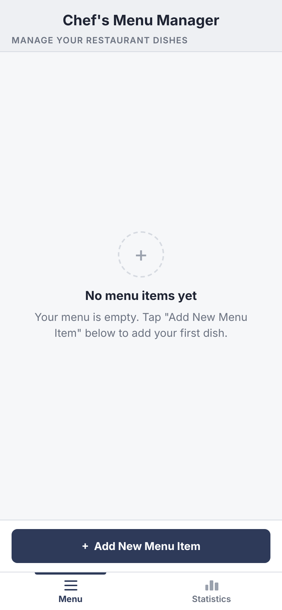
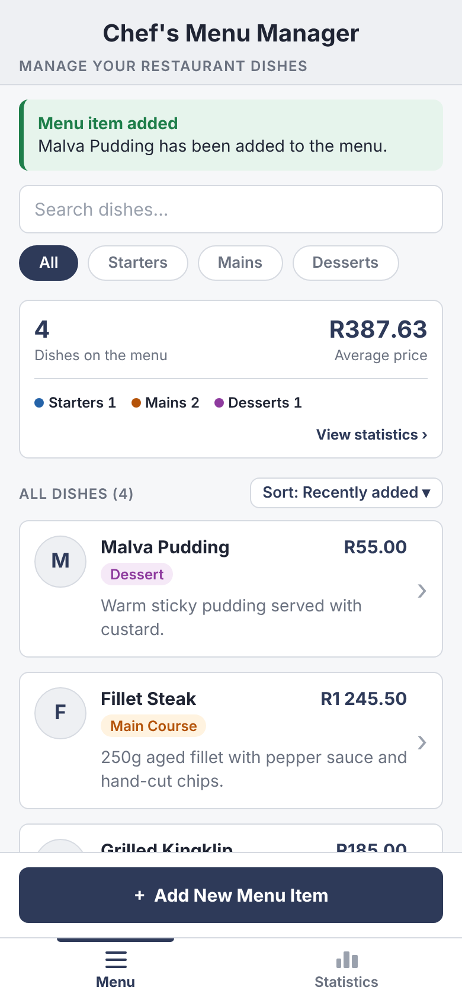
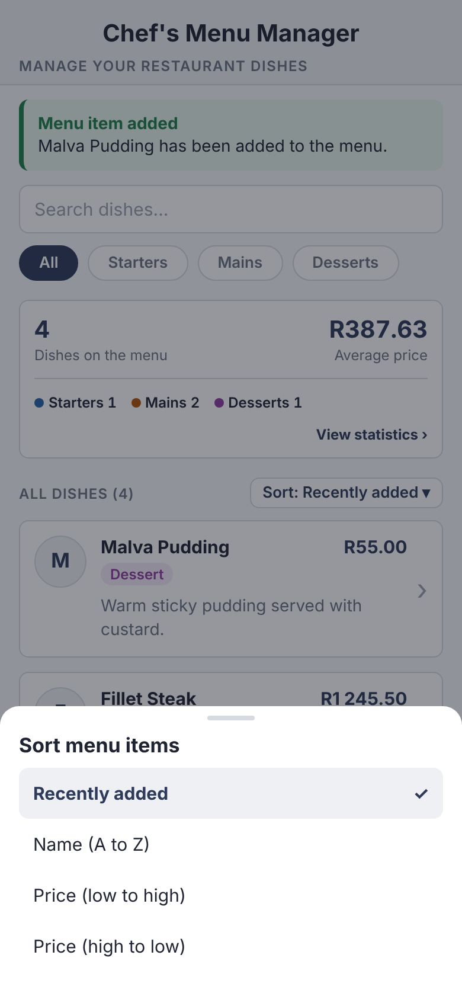
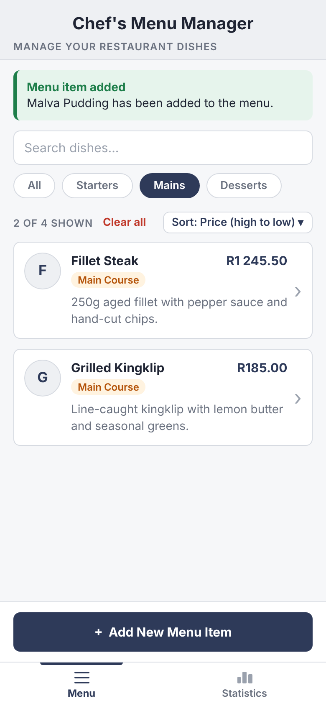
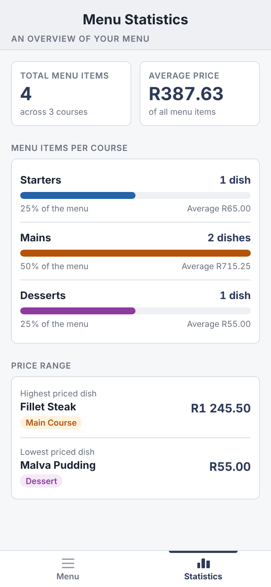
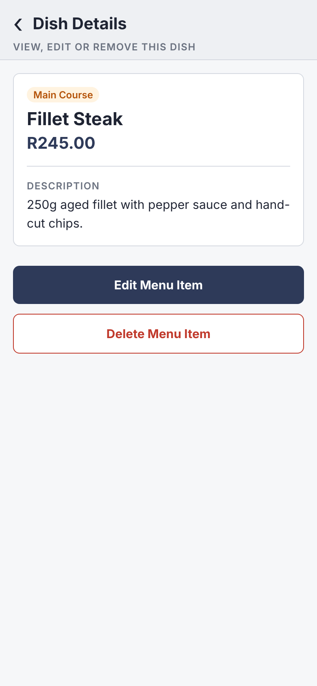
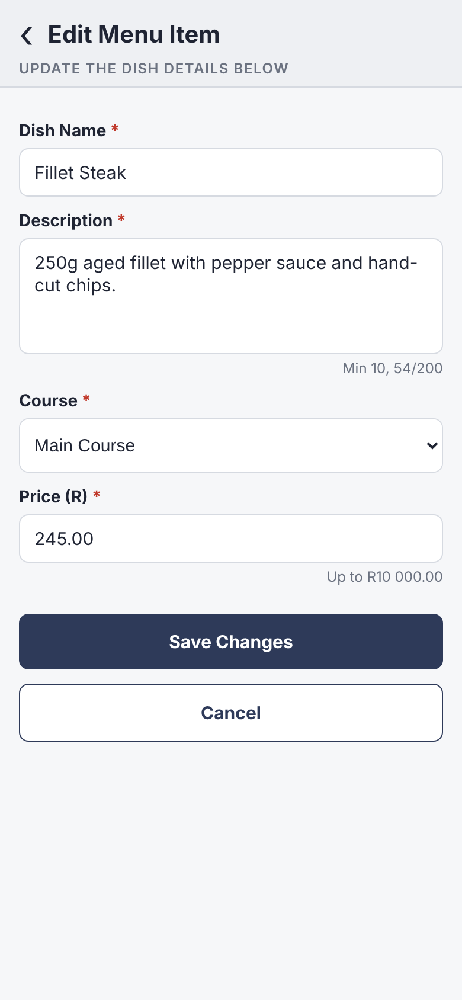
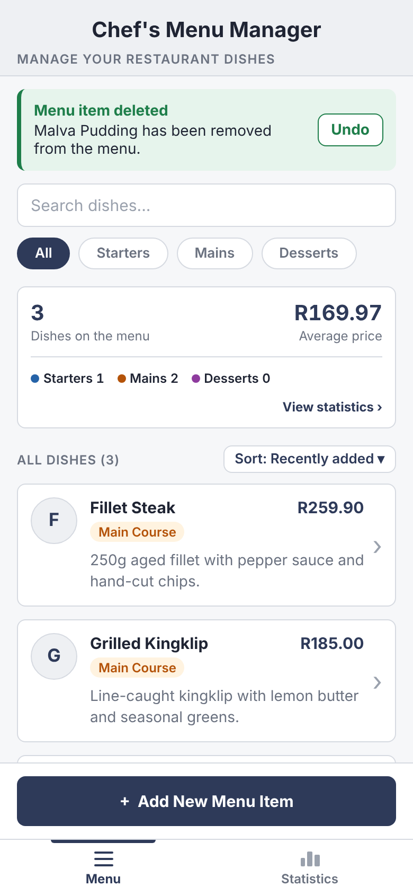
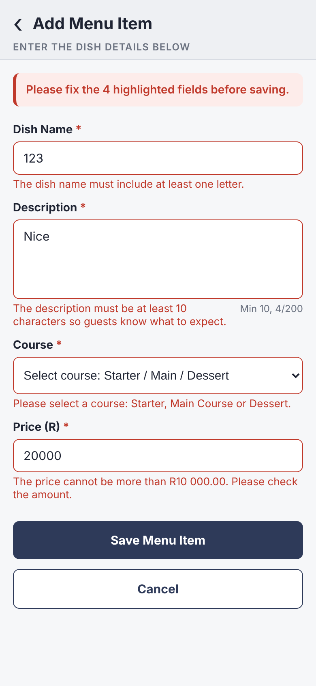
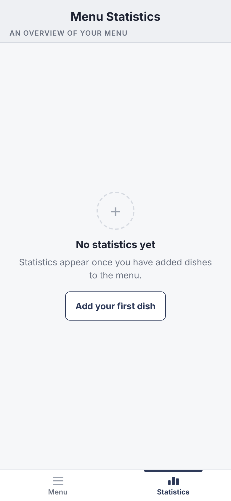

# ChefMenu: Chef's Menu Manager

A React Native (Expo) mobile application that lets Christoffel, the chef, manage his restaurant menu from his phone. He can add, view, edit, delete, search, filter and sort dishes, undo a deletion, and see statistics about his menu on their own screen. This is the final version of the app for Part 3 of the MAST5112 Portfolio of Evidence.

| | |
|---|---|
| **Module** | MAST5112 |
| **Assessment** | Portfolio of Evidence, Part 3 (Final) |
| **Student** | Theolin Chetty (ST10507916) |
| **Lecturer** | Mr. K. Garanganga |
| **Version** | 3.0.0 |
| **Part 3 video demonstration** | **[PASTE_YOUR_PART_3_VIDEO_LINK_HERE](PASTE_YOUR_PART_3_VIDEO_LINK_HERE)** (see also [VIDEO_LINK.md](VIDEO_LINK.md)) |

> **Part 3 video demonstration:** [PASTE_YOUR_PART_3_VIDEO_LINK_HERE](PASTE_YOUR_PART_3_VIDEO_LINK_HERE)

## Contents

1. [How the Part 3 requirements are met](#how-the-part-3-requirements-are-met)
2. [Features](#features)
3. [Change log since Part 2](#change-log-since-part-2)
4. [Refactoring](#refactoring)
5. [Testing](#testing)
6. [Screenshots](#screenshots)
7. [React Native components used](#react-native-components-used)
8. [Project structure](#project-structure)
9. [Running the app](#running-the-app)
10. [References](#references)

## How the Part 3 requirements are met

| Requirement | Where to find it in the app |
|---|---|
| **1. Manage menu items** (edit, update, delete) | Tap any dish to open **Dish Details**. **Edit Menu Item** opens the form with the dish already filled in, and **Save Changes** updates it. **Delete Menu Item** asks for confirmation, then removes it, with an **Undo** button. The list and statistics update straight away. |
| **2. Search and filter** | The **search bar** finds dishes by name as you type. The **All / Starters / Mains / Desserts** chips filter by course. **Clear** in the search bar, **Clear all** above the list, or **Show all dishes** on the "No matching dishes" message brings every dish back. |
| **3. Menu statistics** | The **Statistics** tab shows the total number of menu items, the average price of all items, the number of items in each course with a bar for each, and the highest and lowest priced dishes. A short summary also sits at the top of the menu list. |
| **4. Enhance the application** | See the [change log](#change-log-since-part-2) and [refactoring](#refactoring) sections: reusable components, reusable functions and a custom hook, clearer folders, stronger validation, sorting, undo, and unit tests. |
| **5. User experience** | A tab bar for clear navigation, back arrows on every inner screen, success banners for every action, error messages under each field, confirmation before deleting or discarding changes, and one shared look across all four screens. |

## Features

- **Add menu items** with a Dish Name, Description, Course (Starter, Main Course or Dessert) and Price.
- **View all menu items** in a scrollable list showing the name, course, description and price of each dish.
- **Dish Details screen** that opens when a dish is tapped.
- **Edit menu items** using the same form as adding, already filled in with the dish's current details.
- **Delete menu items** after confirming in a popup, with an **Undo** button in case of a mistake.
- **Search** dishes by name (the description is searched too).
- **Filter** the list by course using the All, Starters, Mains and Desserts chips from the Part 1 wireframe.
- **Sort** the list by most recently added, name, or price (low to high, or high to low).
- **Statistics screen** with the total number of dishes, the average price, dishes per course with bars, the average price per course, and the highest and lowest priced dishes.
- **Tab bar** for moving between the Menu and Statistics screens.
- **Saved menu** that is stored on the device, so the menu is still there after the app is closed.
- **Validation** for every field, with clear error messages, including duplicate dish names and checks as soon as the chef leaves a field.
- **Confirmation messages** after a dish is added, updated, deleted or restored.

## Change log since Part 2

Versions are tagged in this repository:

| Tag | What it is |
|---|---|
| `part-2` | The first working version from Part 2 (add and view menu items). |
| `v2.0.0` | Edit, delete, search, filter and statistics added after Part 2. |
| `v3.0.0` | The final Part 3 version described in this README. |

To look at an older version, run `git checkout part-2` or `git checkout v2.0.0`.

### Version 3.0.0 (Part 3)

#### Added

- **Statistics screen.** A new screen, reached from the tab bar, that shows:
  - the total number of menu items
  - the average price of all menu items
  - the number of menu items in each course, with a coloured bar for each course so they can be compared at a glance
  - the share of the menu each course makes up, as a percentage
  - the average price in each course
  - the highest and lowest priced dishes, which open their Dish Details when tapped

  When the menu is empty, the screen shows "No statistics yet" with an "Add your first dish" button instead of a row of zeros.
- **Tab bar** at the bottom of the main screens with **Menu** and **Statistics** tabs. The selected tab is highlighted with a bar and darker icon and text.
- **Sorting.** A "Sort" button above the list opens a panel with four options: Recently added, Name (A to Z), Price (low to high) and Price (high to low). The current choice is shown on the button. Sorting works together with search and filter.
- **Undo delete.** After a dish is deleted, the "Menu item deleted" banner has an **Undo** button for 6 seconds. Tapping it puts the dish back in the same place and shows "Deletion undone".
- **"Clear all" link** above the list whenever a search or course filter is active, so the chef can show every dish again with one tap instead of clearing the search and the filter separately.
- **Checks when leaving a field.** The dish name, description and price are checked as soon as the chef moves to the next field, so mistakes show up before pressing Save. Empty fields are only flagged on Save, so the form does not fill with red while the chef is still tabbing through it.
- **New validation rules:**
  - the dish name must contain at least one letter, so "123" is not accepted
  - the description must be at least 10 characters, so guests know what to expect
  - the price cannot be more than R10 000.00, to catch typing mistakes such as an extra zero
- **Helper text** under the description ("Min 10" plus the character count) and the price ("Up to R10 000.00"), so the chef knows the rules before an error appears.
- **Unit tests.** 36 automated tests for the validation, search, filter, sort, statistics and formatting functions. Run them with `npm test`. See [Testing](#testing).
- **Date added** is now saved with each new dish, so "Recently added" sorting is exact. Dishes saved by version 2 are still sorted correctly using the time stored in their id.

#### Changed

- **Home screen statistics** are now a shorter summary showing the total, the average price and the number of dishes in each course, with a "View statistics" link to the full Statistics screen. The summary hides while searching or filtering so the matching dishes are easier to see.
- **New dishes now appear at the top of the list** (sorted by "Recently added"), so the chef sees the dish they just added straight away.
- **Prices use a space between thousands**, the South African style, for example R1 245.50 instead of R1245.50.
- **Extra spaces are removed** from the dish name and description when saving, so "Grilled   Kingklip" is saved as "Grilled Kingklip".
- **The "No matching dishes" message** now says what was searched for and in which course, for example: No dishes match "pudding" in Main Course. Its button is now called "Show all dishes".
- **The result count** above the list is shorter ("2 of 4 shown") so it fits on one line next to "Clear all" and the Sort button.
- **The success banner** can now show an action button (used for Undo).
- The app version in `package.json` changed from 2.0.0 to 3.0.0.
- README updated with a requirements table, this change log, the Part 3 refactoring, testing notes and new screenshots.

#### Fixed

- The "Add New Menu Item" footer is slimmer, so more dishes still fit on screen now that the tab bar sits below it.
- The price error message no longer overlaps the price helper text; the helper hides while an error is showing.

### Version 2.0.0

#### Added

- **Dish Details screen** (Screen 3 from the Part 1 design). Tapping a dish in the list opens a screen showing its course, name, price and full description, with Edit and Delete buttons.
- **Edit a menu item.** The Edit button opens the form with the dish's details already filled in. The screen title changes to "Edit Menu Item" and the button changes to "Save Changes". Saving updates the existing dish instead of creating a copy.
- **Delete a menu item.** The Delete button shows a "Delete this item?" popup with "No, keep it" and "Delete" options, matching the decision point in the Part 1 flow diagram.
- **Search bar** on the menu list that finds dishes as the chef types, with a Clear button.
- **Course filter chips** (All, Starters, Mains, Desserts) that show only the dishes from the selected course.
- **Menu statistics card** at the top of the list with the total number of dishes, the overall average price, and the count and average price for each course.
- **Result count** above the list while searching or filtering.
- **"No matching dishes" message** with a button to clear the search and filter. This is separate from the empty menu message.
- **Saved menu using AsyncStorage.** The menu is saved on the device every time it changes and loaded again when the app opens. A loading message shows while the saved menu is being read.
- **Duplicate name check.** The form stops the chef from saving two dishes with the same name (not case sensitive).
- **Discard changes popup.** If the chef taps Cancel or the back arrow after typing in the form, the app asks "Discard changes?" before leaving.
- **Chevron on each dish card** to show that the card can be tapped.
- **Red "danger" button style** for the Delete button and destructive popup actions.

#### Changed

- The confirmation banner shows a different title for each action: "Menu item added", "Changes saved" or "Menu item deleted".
- Confirmations use the in-app banner on every platform. The Part 2 version also showed a system Alert on Android and iOS, which interrupted the chef with a second tap.
- The search bar, filter chips and statistics only appear once the menu has at least one dish.

#### Fixed

- Dish names are compared without extra spaces when checking for duplicates.
- If the dish being viewed no longer exists, the app returns to the menu list instead of showing an empty screen.

## Refactoring

Each round of refactoring was done in its own commit before the new features were added, so the history shows the clean-up separately from the new work.

### Part 3 refactoring (version 3.0.0)

| What changed | Before | After | Why |
|---|---|---|---|
| **Search and filter state** | `searchText`, `courseFilter`, the filtered list and `clearFilters()` were all written inside `MenuListScreen.tsx`. | Moved into a custom hook, `useMenuFilters()` in `src/hooks/useMenuFilters.ts`, which now also handles the sort order. | The list screen now only handles layout, and the search, filter and sort logic lives in one place. |
| **Course names and labels** | `COURSES` lived in `types.ts`, and the chip labels (Starters, Mains, Desserts) were typed out inside `CourseFilterChips.tsx`. | Moved to `src/constants/courses.ts` as `COURSES`, `COURSE_PLURAL_LABELS` and `COURSE_FILTERS`. | The filter chips, statistics screen and home summary all use the same labels, and `types.ts` now only holds types. |
| **Card styling** | The same white background, border and rounded corners were written out separately in the dish card, statistics card and details screen. | New `Card` component and shared `cardStyle` in `src/components/Card.tsx`. | One place to change the look of every card, which keeps all screens consistent. |
| **Course badge** | The coloured course label was built by hand in both `MenuItemCard` and `DishDetailsScreen`. | New `CourseBadge` component. | Removes repeated code; also reused on the Statistics screen. |
| **Empty messages** | The empty menu and "No matching dishes" messages were written out inside the list screen with their own styles. | New `EmptyState` component with a title, message, optional icon and optional button. | Reused for the empty menu, no matches, and the empty Statistics screen. |
| **Id creation** | The id formula was written inside the form's save function. | Moved to `createId()` in `src/utils/id.ts`. | A meaningful name for what the code does, and easy to reuse. |
| **Statistics calculations** | `menuStats.ts` had a private `average()` helper and only worked out counts. | `averagePrice()` is now exported and reused, and the stats include each course's share and the highest and lowest priced dishes. | The Statistics screen needed more figures, and the shared function avoids writing the average twice. |
| **Search matching** | The search check was written inline inside `filterMenuItems()`. | Split into its own `matchesSearch()` function. | Easier to read and to test on its own. |
| **Validation** | Only `validateMenuItem()` existed, and text was trimmed in the screen. | Added `validateField()` for checking one field, and `cleanText()` for removing extra spaces. The rule limits are named constants (`MIN_DESCRIPTION_LENGTH`, `MAX_PRICE`). | Lets the form check a single field when the chef leaves it, and keeps all rules and limits in one file. |
| **Navigation** | Routes were list, details and form. | Added a `stats` route and a `Tab` type, and the main screens share one `TabBar`. | Clear navigation between the two main sections of the app. |
| **Old statistics card** | `MenuStatsCard.tsx` showed all statistics on the home screen. | Removed. Replaced by `StatsSummary` on the home screen and the full `StatisticsScreen`. | Avoids two components showing the same figures in different ways. |
| **TypeScript setup** | No test types. | `tsconfig.json` includes Jest types so the test files are type-checked too. | Catches mistakes in the tests as well as the app. |

### Earlier refactoring (version 2.0.0)

| What changed | Part 2 | Version 2.0.0 | Why |
|---|---|---|---|
| **Where the menu data lives** | A `useState` array in `App.tsx`, passed down to screens as props. | `MenuContext` using `useReducer` with ADD, UPDATE, DELETE and LOAD actions (RESTORE was added in 3.0.0 for Undo). Screens read it with the `useMenu()` hook. | Several screens need the menu. Context avoids passing props through `App.tsx`, and the reducer keeps every change to the menu in one place. |
| **Validation rules** | Written inside `AddMenuItemScreen.tsx`. | Moved to `src/utils/validation.ts`. | The rules are shared by adding and editing, and the screen file only handles the layout. |
| **Price formatting** | `formatPrice()` was exported from `MenuItemCard.tsx`. | Moved to `src/utils/format.ts`. | It is used by several screens, so it belongs in a shared file. |
| **Add screen** | `AddMenuItemScreen.tsx`, add only. | Renamed to `MenuItemFormScreen.tsx` with an optional `initialItem` prop, so one screen handles both adding and editing. | Avoids building a second, almost identical edit screen. |
| **Form fields** | Each field repeated its own label, required star and error text. | New `FormField` component. | Removes repeated markup and keeps every field looking the same. |
| **Form state** | Four separate `useState` calls and a `clearError()` helper. | One `values` object and one `updateField()` function. | Simpler to fill in when editing, and easier to check whether anything changed. |
| **Banners** | Success and error banners were styled separately. | New `StatusBanner` component. | One component for every message. |
| **Buttons** | `AppButton` used an `isPrimary` check. | Style lookups by variant, plus a `danger` variant. | Adding variants no longer needs extra if statements. |

## Testing

The shared functions in `src/utils/` are covered by 36 unit tests written with Jest (`jest-expo`). They are in `src/utils/__tests__/`.

```bash
npm test
```

| Test file | What it checks |
|---|---|
| `validation.test.ts` | Valid dishes pass; empty fields, duplicate names, number-only names, short descriptions, invalid prices, zero and over-limit prices are rejected; a comma is accepted in the price. |
| `filterAndSort.test.ts` | Search by name ignores case; course filter; search and filter together; every sort order; sorting does not change the original list; older dishes without a date still sort. |
| `menuStats.test.ts` | Total items, average price, items per course, course share and average, highest and lowest dish, and an empty menu. |
| `format.test.ts` | Rand formatting with thousands spaces, singular and plural words, and percentages. |

The app was also tested by hand on the web build: adding dishes, every validation message, editing, deleting and undoing, search, each filter, each sort order, the statistics updating, and the menu still being there after a refresh.

## Screenshots

| Empty menu | Menu list | Sort options | Search and filter |
|---|---|---|---|
|  |  |  |  |

| Statistics | Dish details | Edit | Delete with Undo |
|---|---|---|---|
|  |  |  |  |

| Validation | Statistics with no dishes |
|---|---|
|  |  |

## React Native components used

| Requirement | Component | Where |
|---|---|---|
| Display headings and text | `Text` | All screens |
| Enter the dish name, description and price | `TextInput` (`multiline` for the description, `keyboardType="numeric"` for the price) | Menu item form |
| Select a course | `Picker` from `@react-native-picker/picker` | Menu item form |
| Buttons, dish cards, chips and tabs | `TouchableOpacity` | All screens |
| Display menu items | `FlatList` (with `ListHeaderComponent` and `ListEmptyComponent`) | Menu list |
| Search dishes | `TextInput` | Menu list |
| Scrolling filter chips | `ScrollView` (`horizontal`) | Menu list |
| Confirmation popups and the sort panel | `Modal` and `Pressable` | Dish details, form, menu list |
| Loading the saved menu | `ActivityIndicator` | Menu list |
| Saving the menu | `AsyncStorage` | `MenuContext` |
| Layout and safe screen edges | `View`, `ScrollView`, `KeyboardAvoidingView`, `SafeAreaView` | All screens |

## Project structure

- `App.tsx`: wraps the app in `MenuProvider`, chooses which screen to show, and shows the tab bar on the main screens.
- `src/types.ts`: the `MenuItem`, `Course`, `CourseFilter`, `SortOrder`, `Tab` and `Route` types.
- `src/theme.ts`: shared colours, spacing and font sizes.
- `src/constants/courses.ts`: course names and their labels.
- `src/context/MenuContext.tsx`: menu data, reducer (including Undo), and saving to the device.
- `src/hooks/useMenuFilters.ts`: search, course filter and sort state for the menu list.
- `src/utils/`: `validation.ts`, `format.ts`, `filterMenu.ts`, `sortMenu.ts`, `menuStats.ts` and `id.ts`, with their tests in `__tests__/`.
- `src/components/`: `AppHeader`, `AppButton`, `Card`, `CourseBadge`, `CourseFilterChips`, `ConfirmDialog`, `EmptyState`, `FormField`, `MenuItemCard`, `OptionSheet`, `SearchBar`, `StatsSummary`, `StatusBanner` and `TabBar`.
- `src/screens/MenuListScreen.tsx`: the menu list.
- `src/screens/MenuItemFormScreen.tsx`: the add and edit form.
- `src/screens/DishDetailsScreen.tsx`: dish details.
- `src/screens/StatisticsScreen.tsx`: menu statistics.
- `docs/screenshots/`: screenshots used in this README.

## Running the app

**Requirements:** Node.js 20 or later and the Expo Go app on an Android or iOS phone (or an Android emulator).

```bash
git clone https://github.com/ST10507916/MAST5112-ChefMenu-ST10507916.git
cd MAST5112-ChefMenu-ST10507916
npm install
npx expo start
```

Scan the QR code with Expo Go (Android) or the Camera app (iOS). You can also press `a` to open an Android emulator, or `w` to open it in a web browser.

## Tech stack

- Expo SDK 57
- React Native 0.86
- TypeScript
- @react-native-picker/picker
- @react-native-async-storage/async-storage
- react-native-safe-area-context
- Jest with jest-expo (unit tests)

## References

Expo (2026) *Expo documentation*. Available at: https://docs.expo.dev (Accessed: 11 November 2026).

Expo (2026) *Unit testing with Jest*. Available at: https://docs.expo.dev/develop/unit-testing/ (Accessed: 11 November 2026).

Meta Platforms, Inc. (2024) *React Native documentation*. Available at: https://reactnative.dev/docs/getting-started (Accessed: 11 November 2026).

Meta Platforms, Inc. (2024) *FlatList*. React Native documentation. Available at: https://reactnative.dev/docs/flatlist (Accessed: 11 November 2026).

Meta Platforms, Inc. (2024) *Modal*. React Native documentation. Available at: https://reactnative.dev/docs/modal (Accessed: 11 November 2026).

Meta Platforms, Inc. (2024) *Reusing logic with custom hooks*. React documentation. Available at: https://react.dev/learn/reusing-logic-with-custom-hooks (Accessed: 11 November 2026).

Meta Platforms, Inc. (2024) *useReducer*. React documentation. Available at: https://react.dev/reference/react/useReducer (Accessed: 11 November 2026).

Meta Platforms, Inc. (2024) *useContext*. React documentation. Available at: https://react.dev/reference/react/useContext (Accessed: 11 November 2026).

OpenJS Foundation (2024) *Jest documentation*. Available at: https://jestjs.io/docs/getting-started (Accessed: 11 November 2026).

React Native Async Storage (2024) *Async Storage*. Available at: https://react-native-async-storage.github.io/async-storage/ (Accessed: 11 November 2026).

React Native Community (2024) *@react-native-picker/picker*. Available at: https://github.com/react-native-picker/picker (Accessed: 11 November 2026).

Nielsen, J. (1994) *10 usability heuristics for user interface design*. Nielsen Norman Group. Available at: https://www.nngroup.com/articles/ten-usability-heuristics/ (Accessed: 11 November 2026).
