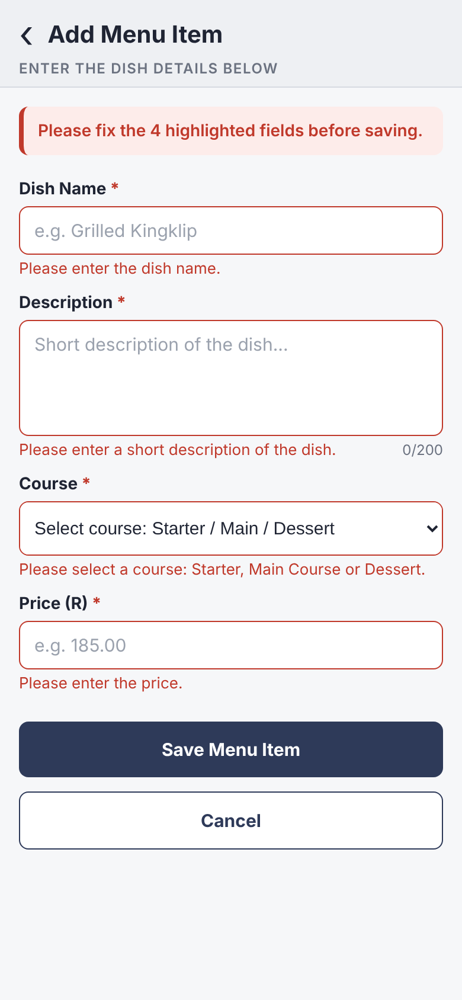
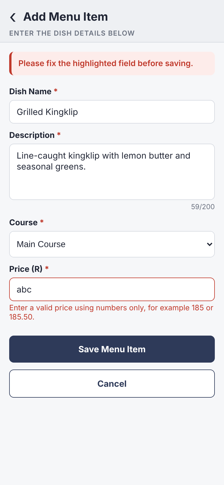
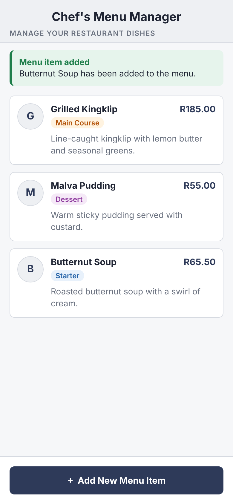

# ChefMenu: Chef's Menu Manager

A React Native (Expo) mobile application that lets a chef add dishes to a restaurant menu and view them in a list. This is the first working version of the app, built from the designs in Part 1.

| | |
|---|---|
| **Module** | MAST5112 |
| **Assessment** | Portfolio of Evidence, Part 2 |
| **Student** | Theolin Chetty (ST10507916) |
| **Lecturer** | Mr. K. Garanganga |
| **Video demonstration** | [YouTube (Unlisted)](PASTE_YOUR_YOUTUBE_LINK_HERE) |

## Features in this version

- **Add menu items**: capture the Dish Name, Description, Course and Price for each dish.
- **View all menu items**: every dish appears in a scrollable list with its name, course, description and price.
- **Automatic updates**: the list refreshes as soon as a new dish is saved, and multiple dishes can be added.
- **Validation**: all four fields are required. The price must be a positive number with at most two decimal places (both `185.50` and `185,50` are accepted).
- **Error messages**: each invalid field is outlined in red with a message underneath, plus a summary banner at the top of the form. Errors clear as soon as the chef starts correcting the field.
- **Confirmation**: after saving, a green banner confirms the dish was added (and an alert appears on Android and iOS).
- **Empty state**: a friendly message explains what to do when no menu items have been added yet.
- **Consistent layout**: both screens share the same header, colours, spacing, buttons and text sizes.

Editing, deleting, searching, filtering and menu statistics are planned for the Final PoE.

## Screenshots

| Empty menu | Validation | Price check | Menu list |
|---|---|---|---|
|  |  |  |  |

## React Native components used

These follow the component plan from Part 1.

| Requirement | Component | Where |
|---|---|---|
| Display headings and text | `Text` | All screens |
| Enter the dish name | `TextInput` | Add Menu Item screen |
| Enter the description | `TextInput` (`multiline`) | Add Menu Item screen |
| Select a course | `Picker` from `@react-native-picker/picker` | Add Menu Item screen |
| Enter the price | `TextInput` (`keyboardType="numeric"`) | Add Menu Item screen |
| Save a menu item | `TouchableOpacity` | Add Menu Item screen |
| Display menu items | `FlatList` (with `ListEmptyComponent`) | Menu List screen |
| Layout and safe screen edges | `View`, `ScrollView`, `KeyboardAvoidingView`, `SafeAreaView` | All screens |

## Project structure

```
ChefMenu/
├── App.tsx                        # Holds the menu items and switches between screens
├── src/
│   ├── types.ts                   # MenuItem and Course types, list of courses
│   ├── theme.ts                   # Shared colours, spacing and font sizes
│   ├── components/
│   │   ├── AppHeader.tsx          # Screen title, subtitle and back arrow
│   │   ├── AppButton.tsx          # Primary and secondary button styles
│   │   └── MenuItemCard.tsx       # One dish in the menu list
│   └── screens/
│       ├── MenuListScreen.tsx     # Screen 1: menu list and empty state
│       └── AddMenuItemScreen.tsx  # Screen 2: add menu item form with validation
└── docs/screenshots/              # Screenshots used in this README
```

## How the app works

1. `App.tsx` stores the list of menu items in state using `useState`, so both screens share the same data.
2. The chef taps **+ Add New Menu Item** to open the form.
3. On **Save Menu Item**, the form runs `validate()`. If any field is invalid, the errors are shown and nothing is saved.
4. If the form is valid, a new `MenuItem` object is passed back to `App.tsx`, added to the array, and the app returns to the menu list.
5. Because `FlatList` receives the updated array, the new dish appears immediately along with the confirmation banner.

## Running the app

**Requirements:** Node.js 20 or later and the Expo Go app on an Android or iOS phone (or an Android emulator).

```bash
git clone <your-repo-url>
cd ChefMenu
npm install
npx expo start
```

Then scan the QR code with Expo Go (Android) or the Camera app (iOS). You can also press `a` to open an Android emulator, or `w` to open it in a web browser.

## Tech stack

- Expo SDK 57
- React Native 0.86
- TypeScript
- @react-native-picker/picker
- react-native-safe-area-context

## References

Meta Platforms, Inc. (2024) *React Native documentation*. Available at: https://reactnative.dev/docs/getting-started (Accessed: 12 October 2026).

Meta Platforms, Inc. (2024) *FlatList*. React Native documentation. Available at: https://reactnative.dev/docs/flatlist (Accessed: 12 October 2026).

React Native Community (2024) *@react-native-picker/picker*. Available at: https://github.com/react-native-picker/picker (Accessed: 12 October 2026).

Expo (2026) *Expo documentation*. Available at: https://docs.expo.dev (Accessed: 12 October 2026).

Nielsen, J. (1994) *10 usability heuristics for user interface design*. Nielsen Norman Group. Available at: https://www.nngroup.com/articles/ten-usability-heuristics/ (Accessed: 12 October 2026).
