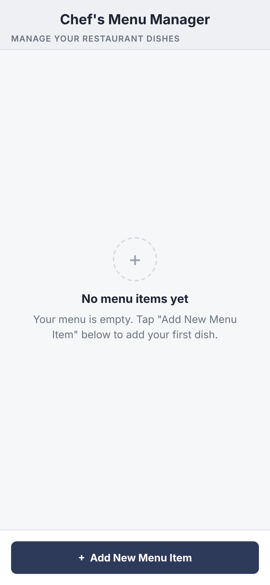
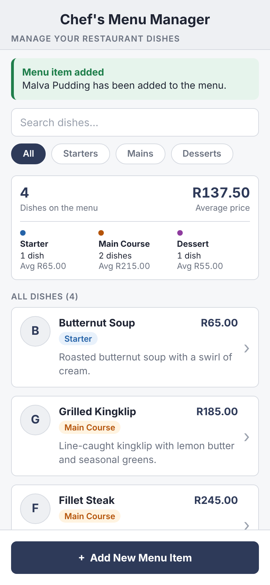
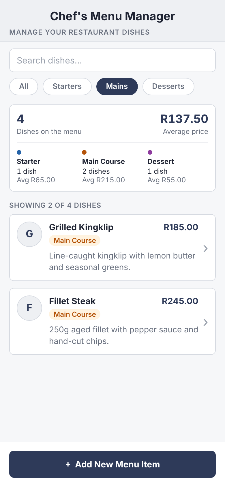
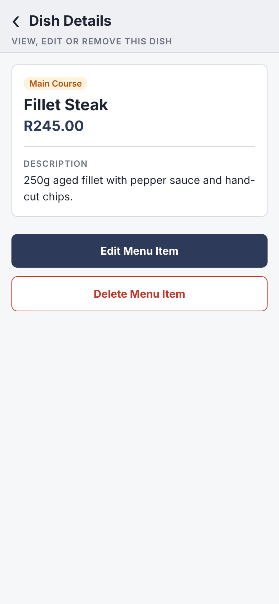
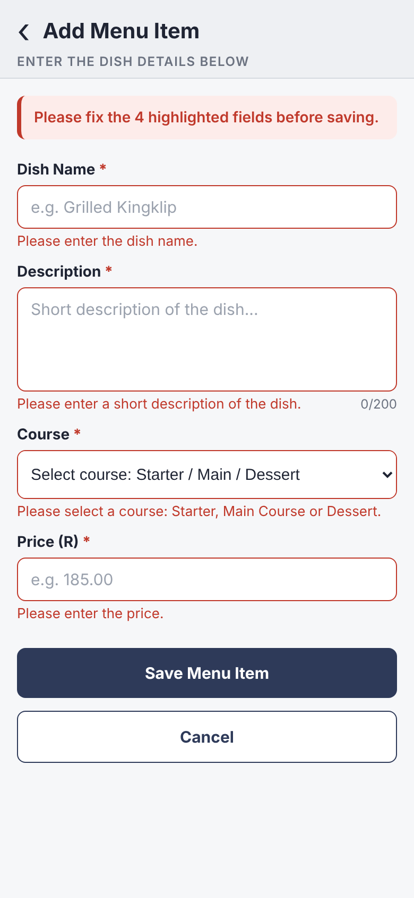
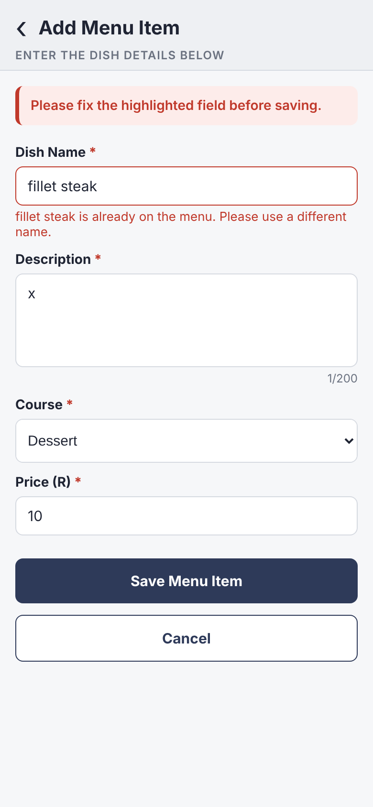
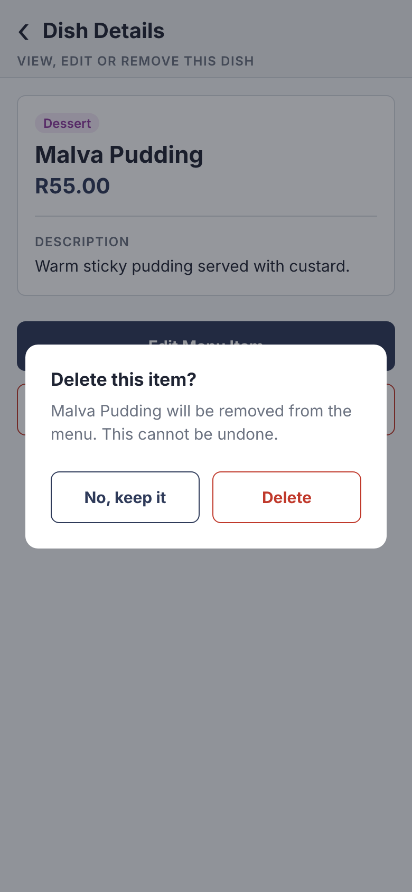
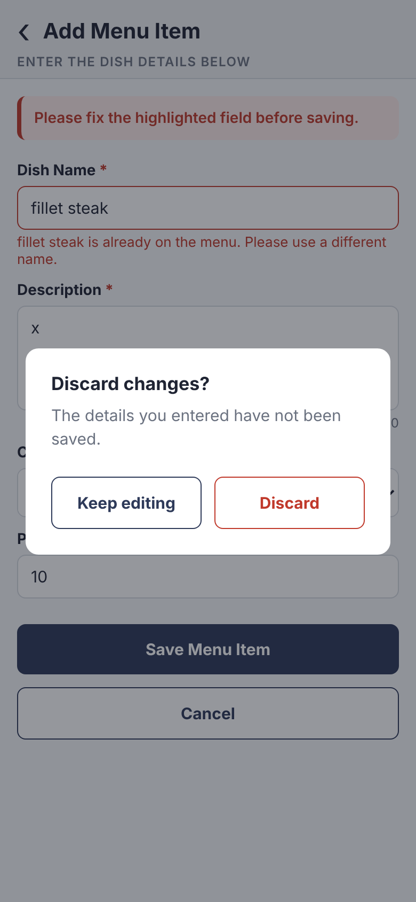

# ChefMenu: Chef's Menu Manager

A React Native (Expo) mobile application that lets Christoffel, the chef, manage his restaurant menu from his phone. He can add, view, edit, delete, search and filter dishes, and see statistics about his menu. This is the final version of the app for the MAST5112 Portfolio of Evidence.

| | |
|---|---|
| **Module** | MAST5112 |
| **Assessment** | Portfolio of Evidence, Final Submission |
| **Student** | Theolin Chetty (ST10507916) |
| **Lecturer** | Mr. K. Garanganga |
| **Version** | 2.0.0 |
| **Video demonstration** | **[https://youtu.be/XxYKS9VI1jk](https://youtu.be/XxYKS9VI1jk)** (see also [VIDEO_LINK.md](VIDEO_LINK.md)) |

> **Video demonstration:** [https://youtu.be/XxYKS9VI1jk](https://youtu.be/XxYKS9VI1jk)

## Contents

1. [Features](#features)
2. [Change log since Part 2](#change-log-since-part-2)
3. [Refactoring](#refactoring)
4. [Screenshots](#screenshots)
5. [React Native components used](#react-native-components-used)
6. [Project structure](#project-structure)
7. [Running the app](#running-the-app)
8. [References](#references)

## Features

- **Add menu items** with a Dish Name, Description, Course (Starter, Main Course or Dessert) and Price.
- **View all menu items** in a scrollable list showing the name, course, description and price of each dish.
- **Dish Details screen** that opens when a dish is tapped, showing its full details.
- **Edit menu items** using the same form as adding, already filled in with the dish's current details.
- **Delete menu items** after confirming in a popup, so dishes are never removed by accident.
- **Search** dishes by name or description.
- **Filter** the list by course using the All, Starters, Mains and Desserts chips from the Part 1 wireframe.
- **Menu statistics** showing the total number of dishes, the overall average price, and the number of dishes and average price for each course.
- **Saved menu** that is stored on the device, so the menu is still there after the app is closed.
- **Validation** for every field, including duplicate dish names, with clear error messages.
- **Confirmation messages** after a dish is added, updated or deleted.

## Change log since Part 2

The Part 2 submission is tagged `part-2` in this repository. Everything below was added or changed after that tag.

### Version 2.0.0 (Final PoE)

#### Added

- **Dish Details screen** (Screen 3 from the Part 1 design). Tapping a dish in the list opens a screen showing its course, name, price and full description, with Edit and Delete buttons.
- **Edit a menu item.** The Edit button opens the form with the dish's details already filled in. The screen title changes to "Edit Menu Item" and the button changes to "Save Changes". Saving updates the existing dish instead of creating a copy.
- **Delete a menu item.** The Delete button shows a "Delete this item?" popup with "No, keep it" and "Delete" options, matching the decision point in the Part 1 flow diagram.
- **Search bar** on the menu list that finds dishes by name or description as the chef types, with a Clear button.
- **Course filter chips** (All, Starters, Mains, Desserts) that show only the dishes from the selected course.
- **Menu statistics card** at the top of the list with the total number of dishes, the overall average price, and the count and average price for each course. It updates straight away when dishes are added, edited or deleted.
- **Result count** above the list, such as "Showing 2 of 4 dishes" while searching or filtering, and "All dishes (4)" otherwise.
- **"No matching dishes" message** with a "Clear search and filter" button when a search or filter finds nothing. This is separate from the empty menu message.
- **Saved menu using AsyncStorage.** The menu is saved on the device every time it changes and loaded again when the app opens. A loading message shows while the saved menu is being read.
- **Duplicate name check.** The form stops the chef from saving two dishes with the same name (not case sensitive, so "fillet steak" and "Fillet Steak" count as the same).
- **Discard changes popup.** If the chef taps Cancel or the back arrow after typing in the form, the app asks "Discard changes?" before leaving, so typed details are not lost by mistake. If nothing was typed, the form closes straight away.
- **Chevron on each dish card** to show that the card can be tapped.
- **Red "danger" button style** for the Delete button and destructive popup actions.

#### Changed

- The confirmation banner now shows a different title for each action: "Menu item added", "Changes saved" or "Menu item deleted".
- Confirmations now use the in-app banner on every platform. The Part 2 version also showed a system Alert on Android and iOS, which interrupted the chef with a second tap and did not appear on web.
- The search bar, filter chips and statistics only appear once the menu has at least one dish, so the empty menu screen stays simple.
- The app version in `package.json` changed from 1.0.0 to 2.0.0.
- README screenshots replaced with screenshots of the final version.

#### Fixed

- Dish names are now compared without extra spaces, so " Malva Pudding " and "Malva Pudding" are treated as the same dish.
- If the dish being viewed no longer exists, the app now returns to the menu list instead of showing an empty screen.

## Refactoring

Before adding the new features, the Part 2 code was refactored so the new screens could share code instead of repeating it. The refactoring is in its own commit, separate from the new features.

| What changed | Part 2 | Final version | Why |
|---|---|---|---|
| **Where the menu data lives** | A `useState` array in `App.tsx`, passed down to screens as props. | `MenuContext` (`src/context/MenuContext.tsx`) using `useReducer` with ADD, UPDATE, DELETE and LOAD actions. Screens read it with the `useMenu()` hook. | Three screens now need the menu. Context avoids passing props through `App.tsx`, and the reducer keeps every change to the menu in one place. |
| **Validation rules** | Written inside `AddMenuItemScreen.tsx`. | Moved to `src/utils/validation.ts` as `validateMenuItem()`, `normalisePrice()` and `countErrors()`. | The rules are now shared by adding and editing, and the screen file only handles the layout. |
| **Price formatting** | `formatPrice()` was exported from `MenuItemCard.tsx`. | Moved to `src/utils/format.ts`. | It is used by the card, the details screen and the statistics card, so it belongs in a shared file instead of a component. |
| **Add screen** | `AddMenuItemScreen.tsx`, add only. | Renamed to `MenuItemFormScreen.tsx` and given an optional `initialItem` prop, so one screen handles both adding and editing. | Avoids building a second, almost identical edit screen. |
| **Form fields** | Each field repeated its own label, required star and error text. | New `FormField` component wraps any input with its label, required marker, error message and optional counter. | Removes the repeated label and error markup from every field and keeps every field looking the same. |
| **Form state** | Four separate `useState` calls and a `clearError()` helper. | One `values` object and one `updateField()` function that also clears that field's error. | Simpler to fill in when editing, and easier to check whether anything changed. |
| **Banners** | The success banner and error banner were styled separately in two screens. | New `StatusBanner` component with `success` and `error` types. | One component for every message, so they all look consistent. |
| **Navigation** | A `'list' \| 'add'` string in state. | A `Route` type: `{ name: 'list' }`, `{ name: 'details', itemId }` or `{ name: 'form', itemId? }`. | The details and edit screens need to know which dish to show. |
| **Buttons** | `AppButton` had primary and secondary styles with an `isPrimary` check. | Style lookups by variant, plus a new `danger` variant. | Adding more variants no longer needs extra if statements. |
| **Statistics and filtering** | Not in Part 2. | Written as pure functions in `src/utils/menuStats.ts` and `src/utils/filterMenu.ts`, called with `useMemo` in the list screen. | Keeps the calculations out of the screen and only reruns them when the menu, search or filter changes. |

## Screenshots

| Empty menu | Home with statistics | Search and filter | Dish details |
|---|---|---|---|
|  |  |  |  |

| Validation | Duplicate name | Delete confirmation | Discard changes |
|---|---|---|---|
|  |  |  |  |

## React Native components used

| Requirement | Component | Where |
|---|---|---|
| Display headings and text | `Text` | All screens |
| Enter the dish name | `TextInput` | Menu item form |
| Enter the description | `TextInput` (`multiline`) | Menu item form |
| Select a course | `Picker` from `@react-native-picker/picker` | Menu item form |
| Enter the price | `TextInput` (`keyboardType="numeric"`) | Menu item form |
| Buttons, dish cards and filter chips | `TouchableOpacity` | All screens |
| Display menu items | `FlatList` (with `ListHeaderComponent` and `ListEmptyComponent`) | Menu list |
| Search dishes | `TextInput` | Menu list |
| Scrolling filter chips | `ScrollView` (`horizontal`) | Menu list |
| Confirmation popups | `Modal` | Dish details, menu item form |
| Loading the saved menu | `ActivityIndicator` | Menu list |
| Saving the menu | `AsyncStorage` | `MenuContext` |
| Layout and safe screen edges | `View`, `ScrollView`, `KeyboardAvoidingView`, `SafeAreaView` | All screens |

## Project structure

- `App.tsx`: wraps the app in `MenuProvider` and chooses which screen to show.
- `src/types.ts`: the `MenuItem`, `Course`, `CourseFilter` and `Route` types.
- `src/theme.ts`: shared colours, spacing and font sizes.
- `src/context/MenuContext.tsx`: menu data, reducer and saving to the device.
- `src/utils/validation.ts`: form validation rules.
- `src/utils/format.ts`: price formatting.
- `src/utils/filterMenu.ts`: search and course filter.
- `src/utils/menuStats.ts`: menu statistics.
- `src/components/`: `AppHeader`, `AppButton`, `MenuItemCard`, `FormField`, `StatusBanner`, `ConfirmDialog`, `SearchBar`, `CourseFilterChips` and `MenuStatsCard`.
- `src/screens/MenuListScreen.tsx`: Screen 1, the menu list.
- `src/screens/MenuItemFormScreen.tsx`: Screen 2, the add and edit form.
- `src/screens/DishDetailsScreen.tsx`: Screen 3, dish details.
- `docs/screenshots/`: screenshots used in this README.

## Running the app

**Requirements:** Node.js 20 or later and the Expo Go app on an Android or iOS phone (or an Android emulator).

```bash
git clone <your-repo-url>
cd ChefMenu
npm install
npx expo start
```

Scan the QR code with Expo Go (Android) or the Camera app (iOS). You can also press `a` to open an Android emulator, or `w` to open it in a web browser.

To see the Part 2 version, run `git checkout part-2`.

## Tech stack

- Expo SDK 57
- React Native 0.86
- TypeScript
- @react-native-picker/picker
- @react-native-async-storage/async-storage
- react-native-safe-area-context

## References

Expo (2026) *Expo documentation*. Available at: https://docs.expo.dev (Accessed: 12 October 2026).

Meta Platforms, Inc. (2024) *React Native documentation*. Available at: https://reactnative.dev/docs/getting-started (Accessed: 12 October 2026).

Meta Platforms, Inc. (2024) *FlatList*. React Native documentation. Available at: https://reactnative.dev/docs/flatlist (Accessed: 12 October 2026).

Meta Platforms, Inc. (2024) *Modal*. React Native documentation. Available at: https://reactnative.dev/docs/modal (Accessed: 12 October 2026).

Meta Platforms, Inc. (2024) *useReducer*. React documentation. Available at: https://react.dev/reference/react/useReducer (Accessed: 12 October 2026).

Meta Platforms, Inc. (2024) *useContext*. React documentation. Available at: https://react.dev/reference/react/useContext (Accessed: 12 October 2026).

React Native Async Storage (2024) *Async Storage*. Available at: https://react-native-async-storage.github.io/async-storage/ (Accessed: 12 October 2026).

React Native Community (2024) *@react-native-picker/picker*. Available at: https://github.com/react-native-picker/picker (Accessed: 12 October 2026).

Nielsen, J. (1994) *10 usability heuristics for user interface design*. Nielsen Norman Group. Available at: https://www.nngroup.com/articles/ten-usability-heuristics/ (Accessed: 12 October 2026).
